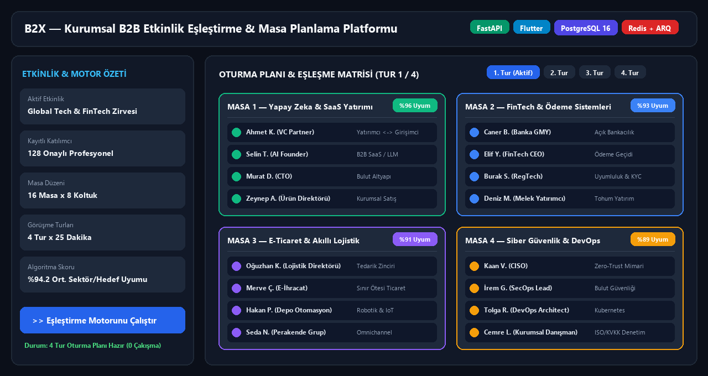
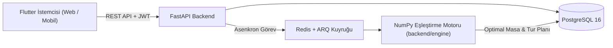

# 🤝 B2X — Kurumsal B2B Etkinlik Eşleştirme ve Oturma Planlama Platformu


Kurumsal etkinliklerde (zirve, fuar, iş forumu) katılımcıların birbiriyle tanışması genelde tesadüfe kalır. **B2X** bunu matematiksel ve planlı hale getirir: katılımcı profillerini, sektör hedeflerini ve beklentilerini karşılaştırarak her görüşme turu için **kimin hangi masada kiminle oturacağını** çakışmasız olarak hesaplar.



---

## 🧠 Sistem Mimarisi



* Ayrıntılı işlevsel şartname: **[`B2X_SPEC.md`](B2X_SPEC.md)**
* Mimari devir-teslim rehberi ve sistem haritası: **[`docs/devir-teslim.md`](docs/devir-teslim.md)**

---

## ✨ Temel Özellikler

* **🎯 Çok Turlu Optimal Eşleştirme Motoru:** Katılımcıların aradığı ve sunduğu yetkinlikleri/sektörleri karşılaştırarak tekrar eden görüşmeleri önleyen bağımsız NumPy tabanlı algoritma (`backend/engine/`).
* **🪑 Dinamik Masa ve Kapasite Planlama:** Çok kişilik yuvarlak masalar veya 1-e-1 görüşme masaları için esnek yerleşim sihirbazı.
* **⚡ Asenkron Kuyruk Mimarisi:** Büyük katılımcı gruplarında eşleştirme hesaplamalarını Redis + ARQ üzerinden (veya in-process fallback ile) kesintisiz çalıştırma.
* **📱 Çoklu Platform İstemci:** Flutter 3.44 (Riverpod & go_router) ile Web, Android ve iOS üzerinde tek kod tabanı.

---

## 📁 Proje Yapısı

| Klasör | İçerik |
|---|---|
| `backend/app/` | FastAPI uygulaması, API uçları, kimlik doğrulama ve veritabanı katmanı |
| `backend/engine/` | Eşleştirme motoru — veritabanı ve HTTP'den bağımsız saf algoritma paketi |
| `app/` | Flutter istemcisi (Android, Web, iOS) |
| `infra/` | Docker Compose servis tanımları |
| `docs/` | Mimari kararlar ve devir-teslim dökümanları |

---

## 🚀 Kurulum ve Çalıştırma

### 1. Ortam Dosyasını Oluşturun
```powershell
Copy-Item .env.example .env   # Linux/macOS: cp .env.example .env
```
> `.env` içindeki `POSTGRES_PASSWORD` ve `JWT_SECRET` değerlerini kendi güçlü anahtarlarınızla güncelleyin.

### 2. Servisleri Başlatın (`db`, `redis`, `api`, `worker`)
```bash
docker compose up -d
docker compose exec api alembic upgrade head
```
* **Swagger API Dokümanı:** `http://localhost:8000/docs`
* **Sağlık Kontrolü:** `http://localhost:8000/health/ready`

### 3. Flutter İstemcisini Çalıştırın
```bash
cd app
flutter pub get
flutter run -d chrome --dart-define=API_BASE_URL=http://localhost:8000
```

---

## 👨‍💻 Geliştirici
**Eren Sezer** — [GitHub Profilim](https://github.com/erensezer07-gif)
